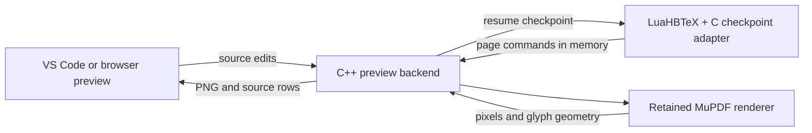

# Move the interactive backend into one persistent C++ process

The Python prototype established real compiler rollback, live page buffers, and
exact source navigation on the bounded acceptance corpus. Profiling then exposed
Python object allocation and garbage-collection pauses around glyph extraction,
alongside repeated serialization between the Windows host and Linux worker.

The `cpp` adapter replaces that interactive implementation. A persistent C++17
process in Linux owns source instrumentation, compact source spans, compiler
checkpoint coordination, page-buffer parsing, retained MuPDF resources, glyph
geometry, selection text, PNG compression, and frame serialization. The compiler
publishes directly into this process through its existing Unix socket. Raw page
commands and per-glyph intermediate objects no longer cross a Python/WSL bridge.

The public interface remains versioned `start`, `edit`, `page`, and `close`
messages over JSON lines, plus status and complete-frame responses. The existing
JavaScript preview consumes the same compact row format. VS Code launches C++
directly through WSL on Windows. A small Node loopback adapter serves the browser
demo; it can launch the Python comparison backend through the same transport.

The controller coalesces queued source updates and marks older frames stale.
After an idle interval it builds a converged candidate in a separate backend
thread/context. Candidate state is adopted only when its source buffers still
match. New work cancels obsolete background builds. Each compiler session owns
its process group and generated directory; shutting it down terminates its
checkpoint children. Rebuilding stages the new executable before replacement;
Windows may require closing running previews to release the old executable.
The build leaves the old binary intact if replacement is refused.

The renderer links MuPDF 1.26.12, matching the PyMuPDF reference's underlying
version. Its C device callbacks produce geometry directly into native vectors.
The established glyph-box convention is retained to avoid changing selection
and reverse-navigation semantics during the port. PNG uses system libdeflate;
resolution and exact RGB values remain unchanged. Dependency versions and
download hashes are pinned by `scripts/build_cpp.py`; notices are in
`native/THIRD_PARTY.md`.

This is a language and ownership change, not a replacement of TeX's state model.
LuaHBTeX still executes in checkpoint children; snapshots still use POSIX fork
at the corpus's explicit file boundaries. Engine-managed differential snapshots,
arbitrary source-position rollback, and native Windows checkpointing remain
separate work. Complete PDFs still seed resources at initialization, convergence,
and resource misses. The bounded source instrumenter's compatibility limits also
remain. The Python implementation stays available as an independent comparison.

The build/test harness may use Python. The default interactive backend does not
invoke Python or construct Python source/glyph objects.
