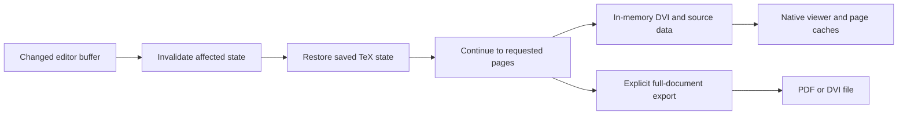

# BaKoMa binary investigation: live DVI and differential compiler state

Read-only investigation of the installed Windows x64 binaries, 2026-10-10. **The evidence strongly supports the user's hypothesis: BaKoMa's interactive path uses in-memory DVI and retained compiler state; PDF is a separate export path.** This is a substantially different architecture from our finalized-PDF preview loop.

The investigation inspected PE exports/imports, selected strings, code references, and disassembly. It did not execute or patch BaKoMa, attach a debugger, or establish a runtime latency distribution. Installation files were unchanged. The [documentation investigation](bakoma-documented-pipeline.md) provides independent first-party corroboration.

## Direct binary evidence

The files inspected were `C:/BaKoMa.TeX/BIN/Win64/{itex.dll,ietex.dll,texword.exe,dview.exe,postwx.exe}`. Exact sizes, SHA-256 hashes, exports, imports, and selected disassembly are in [inspection.json](../results/bakoma-binary/inspection.json). All addresses below are relative virtual addresses (RVAs), specific to those hashes.

| Finding | Evidence | Confidence and limit |
|---|---|---|
| Compiler is a callable component of the editor | `texword.exe` loader at RVA `0xe9f60` calls imported `LoadLibraryA` and `GetProcAddress`, resolving `ContinueTeX`, `Set_SaveState`, `Set_DVI_Procs`, `DVIBUF_Init`, and `DVIBUF_Get`, among other entries. Installed `Config.ctr` maps TeX formats to `itex`/`ietex` libraries. | Confirmed code path. This is not an inference merely from strings or missing PDF dependencies. |
| Live output has a memory-buffer interface | Both compiler DLLs export `DVIBUF_Get` and `DVIBUF_Init`. In `ietex.dll`, `DVIBUF_Get` at `0x4e610` walks a linked list of blocks, checks an offset against block ranges, stores a pointer into the matching block, and returns the remaining contiguous byte count. There are no file or other function calls in this routine. | Confirms an in-memory byte-buffer read interface. It does not mean the entire application performs zero disk I/O. |
| The editor connects to that buffer interface | `texword.exe` resolves `DVIBUF_Get` at `0xea1f9`–`0xea207`; its wrapper at `0xea630` jumps through the stored function pointer. The editor also contains a DVI-buffer document path and DVI rendering/source-position interfaces. | Confirms that the compiler buffer interface is wired into editor code; this was not dynamically traced during a keystroke. |
| DVI output can be redirected through callbacks | `Set_DVI_Procs` at `ietex.dll:0x4e170` stores three supplied callback pointers. `DVIBUF_Init` installs internal buffer handlers. Separate exported input/output open, seek, close, and file-version hooks also exist. | Confirms hooks for integrated I/O. The signatures and all call paths were not exhaustively reconstructed. |
| Compiler state is saved and restored internally | Exports include `Set_SaveState`, `InvalidatePages`, `RestartTeX`, and `ContinueTeX`. The save-state routine allocates state records and links them; restore code selects records using a page or source-file/line position. Diagnostic strings about snapshots and loading states have actual code references. | Strong static evidence of engine-aware rollback, beyond cached page images. |
| State differences are encoded | The routine referencing `Compute_Dif` at `0x48220` processes TeX arrays and calls a helper at `0x47df0`. That helper compares two byte buffers, skips equal bytes, identifies differing runs, and emits lengths/offsets and bytes into segmented storage. Restore code refers to `restore_diff` and traverses retained states. | Confirms difference-based state machinery. Compact undo deltas are a reasonable interpretation; the complete format, scheduling policy, and every side effect remain unproved. |
| Page painting can demand more compilation | The editor has a code-referenced diagnostic for `ContinueTeX (OnPaint)` at `0x506c6`, as well as continuation during source-position search. | Supports demand-driven rendering/compilation. It does not establish the exact prefetch distance. |

Code-reference evidence is in [xrefs.json](../results/bakoma-binary/xrefs.json); the changed-byte comparison loop is in [difference-helper.json](../results/bakoma-binary/difference-helper.json). PE unwind records sometimes describe fragments of a larger function; the recorded boundaries should not be interpreted as a complete reconstructed call graph.

## Evidence from BaKoMa's own scripts and guide

- The [guide](C:/BaKoMa.TeX/BaKoMa/TeXWord/doc/guide.tex:97) explicitly documents saving compiler state after `\begin{document}` to avoid initialization/package loading on first-page edits.
- [Print/export preparation](C:/BaKoMa.TeX/BaKoMa/TeXWord/File.ctr:787) explicitly requests continuation through the entire document. DVI export then serializes it using `dvi.export`.
- [PDF generation](C:/BaKoMa.TeX/BaKoMa/Common/TeXView.ctr:711) invokes that completion step and then a separate PDF-generation operation.
- The [change log](C:/BaKoMa.TeX/BaKoMa/doc/changes7.html:708) documents separate imported-graphics/background caches and an LRU page cache.
- [Caret synchronization](C:/BaKoMa.TeX/BaKoMa/TeXWord/SyncPreview.ctr:78) paints the page to create stop points, then locates the caret using file, line, and column. The compiler's state machinery also has source-state arrays, consistent with source tracking being integrated into the engine.

Taken together, these establish a live DVI-oriented path with PDF generation downstream for export. The conclusion does not depend on assuming that a DLL with no PDF-named imports cannot contain PDF code.

## Why sequential TeX can still feel local

The supported architectural model is:

TeX can remain sequential while avoiding repeated execution of the unchanged prefix. Restoring saved state supplies the already-computed macros, counters, stacks, font data, input positions, and other engine state. Differential storage reduces the amount of state data retained per save. Stopping when requested pages are ready defers later work; cached rendering makes revisits cheaper.

This does **not** establish arbitrary independent paragraph compilation, nor automatic detection that a changed computation has rejoined an unchanged suffix. The latter would require stronger evidence about state equivalence and dependency tracking. It also does not establish that BaKoMa never touches a temporary file.

## How much of our latency is PDF?

The previous 116 ms average compiler stage combined resume overhead, typesetting, page output, and finalization. It was not 116 ms of PDF serialization alone.

Our existing Lua callbacks permit a narrower diagnostic. In 12 retained edit frames from the current demo, the median interval from entry to `finish_pdffile` through entry to `stop_run` was **35.95 ms**. These are retained typing/recovery frames, not the 36-edit comparison benchmark. The interval covers finalization/end-of-run work, and is neither pure PDF CPU time nor a guaranteed saving from another backend. See [recorded intervals](../results/bakoma-binary/our-finalization-window.json).

The callback name can mislead: our field `pdfFinishedUs` records entry to `finish_pdffile`, which occurs **before** final document structure finalization. `stop_run` still allows later housekeeping. These semantics are described in the locally installed [LuaTeX callback manual](C:/texlive/2025/texmf-dist/doc/luatex/base/luatex-callbacks.tex:1029); LuaTeX's [official documentation page](https://www.luatex.org/documentation.html) also stresses matching manuals to the engine version. The Windows manual is newer than the WSL engine, so these callback intervals remain diagnostic rather than a complete profiler attribution.

Our additional average 30 ms renderer stage combines PDF opening, rasterization, glyph extraction, and PNG encoding. Some rendering work is necessary in any implementation; all 30 ms cannot be counted as removable. BaKoMa's direct compiler/viewer connection and persistent caches can nevertheless avoid PDF finalization/reopening, repeated font embedding, and some intermediate transport work.

## Consequence for the prototype

The next engine experiment should keep compiler state and a persistent renderer alive, publish changed page buffers with source origins, and reserve PDF finalization for explicit export. A DVI/XDV path or an equivalent retained display representation is justified by this evidence. It must preserve TikZ graphics operations, font/Unicode behavior, transformations, and exact source navigation.

Simply changing an output flag from PDF to DVI would leave process checkpoint overhead, full-prefix replay, image encoding, transport, and viewer scheduling in place. Matching BaKoMa requires the state-retention and demand-driven rendering architecture as well as avoiding PDF in the interactive path. The binary investigation also gives a concrete direction for native Windows: engine-managed snapshots/deltas, rather than relying exclusively on POSIX process forks.

Reproduce the static inspection with `python scripts/inspect_bakoma_binary.py` followed by `python scripts/inspect_bakoma_xrefs.py`. The scripts use `pefile` and `capstone` installed into `.work/binary-tools`; they never load or execute the inspected DLLs. No application implementation was changed during this investigation.
