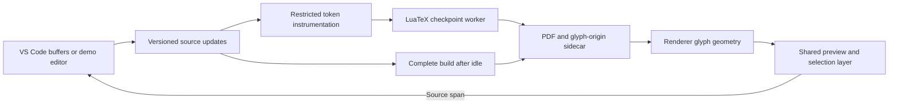

# BaKoMa-style preview: feasibility results

The prototype demonstrates **real checkpoint reuse and precise glyph-to-source navigation together** on the agreed 100-page corpus. It does **not** pass the complete feasibility gate: the measured browser latency exceeds 150 ms, general-document rollback remains unproved, and native Windows checkpointing is unimplemented. The full cross-platform extension should not be represented as finished.

**Update, version 0.0.2:** the [latency optimization report](latency-20261010.md) records an 18% p95 reduction in a fresh back-to-back comparison and restored downstream checkpoints after idle convergence. The measurements below describe the original delivery; the update and current raw result files supersede its latency and convergence limitations where explicitly stated.

## Delivered artifacts

- A [packaged VS Code extension](../artifacts/bakoma-revived-prototype-0.0.2.vsix), with the preview embedded in a webview.
- A [browser demo and run instructions](../README.md), sharing the same preview code and compiler service.
- A [reproducible 100-page corpus](../corpus/main.tex), including Chinese, math, macros, repeated tokens, included files, and TikZ labels.
- A LuaTeX source-provenance experiment, a small POSIX checkpoint module, a versioned preview bridge, and an independent TeXpresso comparison.
- [Raw results](../results), screenshots, environment versions, and source hashes.

The VSIX was packaged and its included entrypoints checked. The shared viewer was exercised in real Chromium. An automated test inside the VS Code extension host has not been run; webview integration is not covered by the browser checks alone.

## Acceptance results

| Requirement | Evidence | Result |
|---|---|---|
| 100-page rendering fidelity | Instrumented and ordinary native LuaLaTeX builds have identical pixels and extracted text on all 100 pages | Pass for this corpus |
| Individual math navigation | Browser clicks distinguish repeated `x` symbols on one source line, a fraction numerator, and a subscript; source selection locates the corresponding glyph | Pass for tested cases |
| Chinese and TikZ text | Browser checks cover a Chinese character, a TikZ math label, and a rotated TikZ math label | Pass for tested cases |
| Macro-origin fallback | Generated glyphs from the fixture's `\fixed` macro navigate to the invocation | Pass for tested macro |
| Stateful incremental compilation | Edits resume from retained LuaTeX process state at an earlier input boundary | Demonstrated, with restricted boundaries |
| Correct invalidation | Incremental output after math, TikZ rotation, and paragraph-reflow changes agrees with complete builds using the same Linux engine | Pass for tested cases |
| Warm ordinary-edit latency | 36 browser samples: 6 text and 6 math edits on each of pages 1, 50, and 100 | **Fail: median 177 ms; p95 277 ms; maximum 4,558 ms** |
| Continuous typing | 16 frames over 2,366 ms: 6.76 updates/second; longest visible freeze 233 ms; scroll stable and caret restored | Visible progress demonstrated; BaKoMa-equivalent smoothness unproved |
| Scroll into invalidated content | Adjacent page: 214 ms; far jump back to page 100 after an early edit: 4,464 ms in the measured sequence | Fast arbitrary scrolling unproved |
| Invalid input and recovery | Prior preview remains visibly stale, source navigation is guarded, and valid input recovers | Pass in browser checks |
| Full-document convergence | Idle-time complete builds update downstream layout and references independently of the quick checkpoint path | Pass in browser checks |
| Native Windows/macOS/Linux | Preview code is separable from its host; the quick compiler path uses Linux process snapshots | **Not established** |

All 14 browser interaction checks passed, with no browser errors. These are corpus-scoped results, not a compatibility claim for arbitrary TeX.

## Measurements and their limits

The original delivery's final browser run measured the source input event through PNG decoding, text-layer updates, and two animation-frame callbacks. Its 36 samples use nearest-rank p95. No correctness-build workload was intentionally run alongside that timing run. This is a browser timing boundary, not a physical monitor scanout measurement. See [browser-latency-before.json](../results/browser-latency-before.json).

This run followed the browser interaction checks in the same live session. The first edit on page 100 took 4,558 ms because earlier edits had invalidated downstream checkpoints. Background convergence can supply a current complete PDF without rebuilding those checkpoints; the next far-page edit then needs prefix replay. That sample is retained in the reported distribution. The later far-scroll result exposes the same limitation. A loaded document alone does not guarantee a usable checkpoint near every edit.

Hardware: Intel Core i9-13900K, 24 cores / 32 logical processors, approximately 128 GiB RAM, Windows 10 with Ubuntu-22.04 under WSL. The snapshot path used Linux LuaHBTeX 1.14 / TeX Live 2022; the separate native instrumentation-equivalence check used LuaHBTeX 1.22 / TeX Live 2025. Incremental-versus-complete comparisons always used matching Linux engine/package/font versions. See [environment.json](../results/environment.json).

The raw checkpoint experiment reports pipeline costs separately from the browser boundary. Those faster numbers must not be substituted for end-to-end latency. Startup includes a complete auxiliary-data pass before checkpoints are retained. A discarded, controlled font/math/TikZ box warms lazy initialization before the first checkpoint; this is specific to the supplied corpus, not permission to pre-execute arbitrary document macros.

The [correctness checks](../results/correctness.json) compare every available incremental page, not just the edited glyph: 50/50 pages after the middle-page math and TikZ edits, and 2/2 available pages after first-page reflow. The complete reflowed reference has 101 pages. Preamble changes refuse unsafe checkpoint reuse and use a rebuilt session.

## How the prototype works

Source identifiers remain attached to glyph nodes through typesetting. At actual shipout, callbacks record the identifiers in emitted-glyph order. The renderer pairs that sequence with its PDF glyph trace, whose geometry includes TikZ transformations. It does not search for matching words or infer source columns from line-level SyncTeX. A glyph-count mismatch disables mapping for that page.

The checkpoint module retains the real TeX/Lua process through POSIX `fork`. A resumed child reopens file descriptions, restores offsets, and truncates generated output files to the saved prefix. Writable descriptors outside the generated session are rejected. The controller invalidates downstream checkpoints before resuming. Preamble or structural changes rebuild the session.

This proves retained computation. It does not prove a disk-free implementation: the runtime keeps compiler state in memory and transfers updates/results through pipes, but TeX still writes session files and finalizes PDF output. A persistent page representation remains a plausible next optimization.

## TeXpresso comparison

The independent checkout at `e8df7709077b2f86f6e16e6c86ceefb86de06f8d` was built in an isolated WSL location with MuPDF include-compatibility fixes and opt-in frame diagnostics. The existing installed checkout was not modified.

The measured request-to-changed-pixel times were approximately 26–82 ms across the three page positions. These include diagnostic capture and exclude VS Code/browser transport. Extracted-text verification did not succeed, so these are **not verified-correct-output timings**. More decisively, the [captured page](../results/texpresso.png) shows the fixture's TikZ labels overlapping and its drawn line missing. That candidate does not pass rendering fidelity on this fixture, regardless of the update times. Its documented synchronization protocol also provides file/line positions rather than the required token spans.

See [raw TeXpresso results](../results/texpresso.json), the [upstream repository](https://github.com/let-def/texpresso), and its [editor protocol](https://github.com/let-def/texpresso/blob/main/EDITOR-PROTOCOL.md).

## Recommendation and outstanding work

Retain the LuaTeX checkpoint/provenance prototype as the working research baseline, with TeXpresso as a performance comparison. A shipping engine has not been selected.

Before the full extension can satisfy the task:

1. Bring the **complete visible-update path**, including browser work, below the 150 ms p95 target. Avoid substituting backend timing for this gate.
2. Replace corpus-specific source rewriting with robust engine-level provenance. Arbitrary macros, ligatures/grapheme caret positions, catcode changes, verbatim material, non-glyph math constructs, and third-party packages still need coverage.
3. Generalize checkpoints and invalidation to ordinary documents without one explicit input file per page. Establish dependency correctness for floats, counters, bibliography tools, generated content, and arbitrary reflow.
4. Reduce far-scroll latency through validated continuation/prefetching and reuse, while preserving correct source revision boundaries.
5. Establish a native Windows state-retention strategy and test macOS. Linux `fork` is a feasibility mechanism, not a portable final design.
6. Exercise the packaged extension in the real VS Code host and expand the compatibility corpus before distributing it as a general LaTeX editor.

The BaKoMa observations remain useful architectural clues. The inspected scripts establish page invalidation, continuation, buffered content, and file/line/column caret operations; they do not disclose a complete portable incremental engine.
